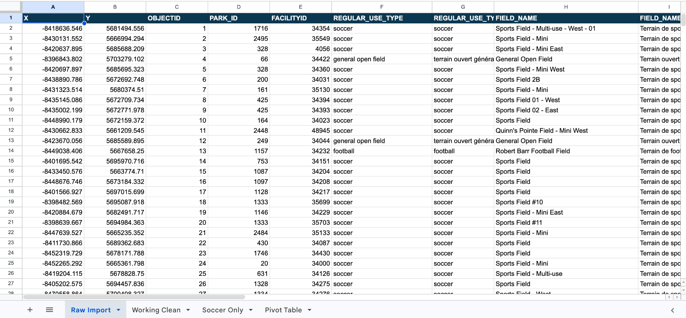
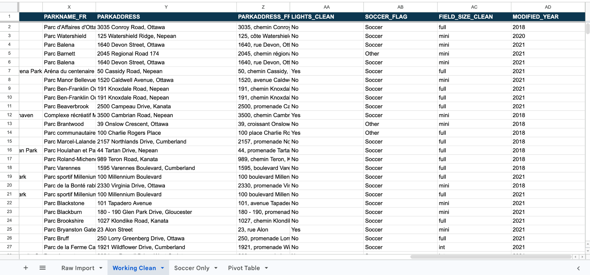
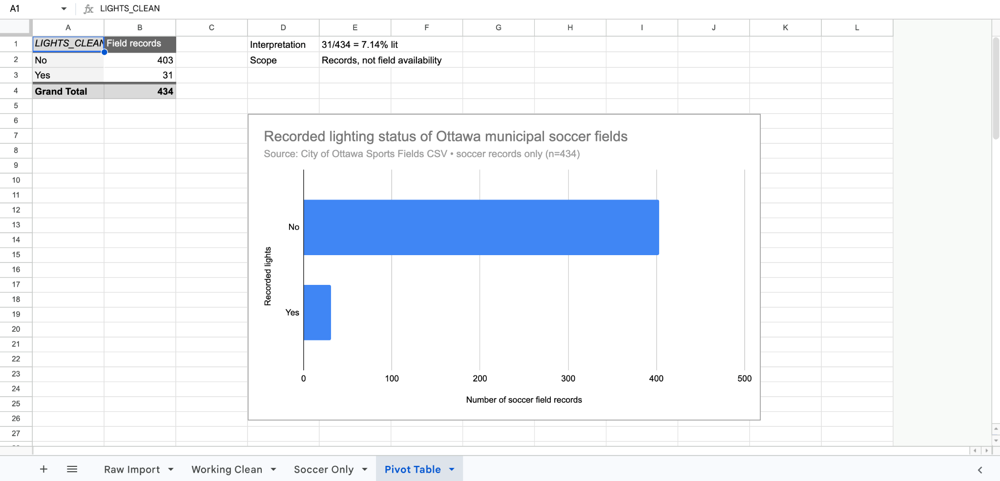
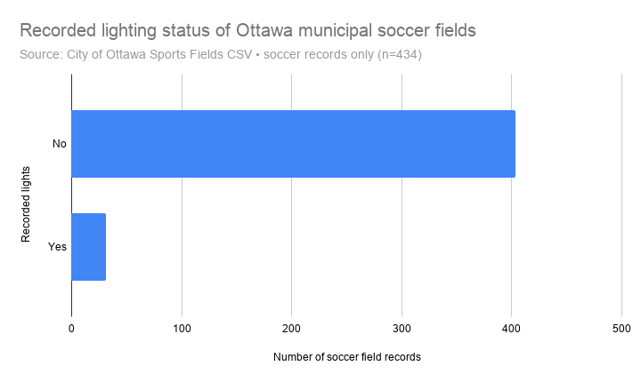
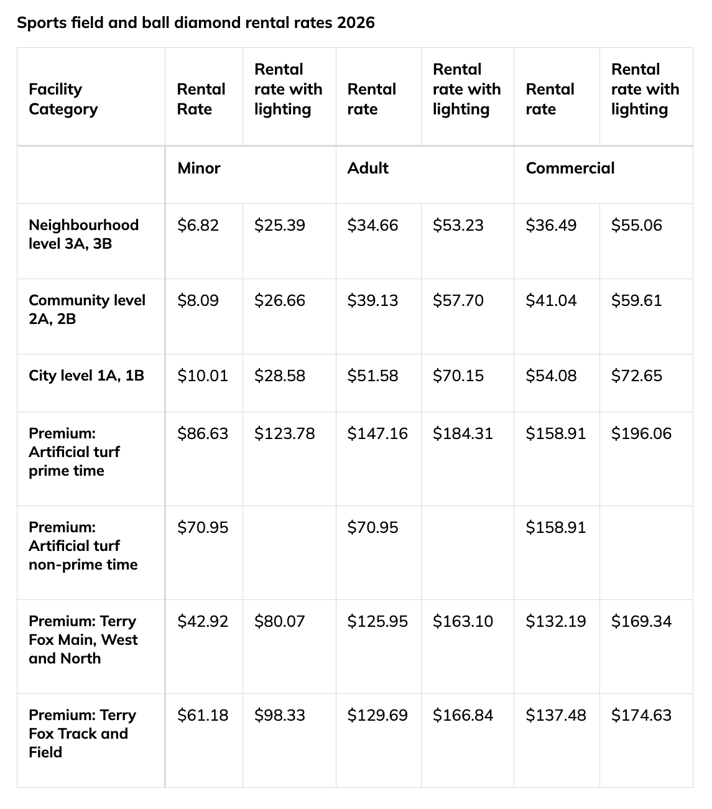

November 5, 2026  
MPAD 2003 — Introductory Data Storytelling  
Mootaz Matraji  
Presented to Jean-Sébastien Marier

# Deliverable 2: Exploratory Data Analysis — After Sunset: Exploring Lighting at Ottawa Soccer Fields

## 1. Getting Data

For this assignment, I analyzed the City of Ottawa’s [Sports Fields dataset](https://open.ottawa.ca/datasets/4a93cd91adb64e38b20aa3edfe2d6148_19) to investigate how many municipal soccer fields have recorded lighting (City of Ottawa, n.d.-a). The data represents sports-field locations on City-owned or leased property; it does not include every school or private field. 

To reproduce the import, download the CSV from Open Ottawa. In Google Sheets, create a blank spreadsheet, choose **File → Import → Upload**, select the CSV, set the separator to **Comma** if necessary, and choose **Insert new sheet(s)**. Rename the resulting tab `Raw Import`, verify that row 1 contains the original headings, and leave it unchanged. The screenshot below shows the original column headings and rows 2–27.

**Google Sheets workbook:** [Ottawa Sports Fields — Raw and Cleaned Analysis](https://docs.google.com/spreadsheets/d/1Zu9UfTZvQte1w2r5IgiBp1ayMuaG0DrAsu3lpN2m8TY/edit).



The supplied CSV has **526 data rows and 26 columns**. There are no blank `LIGHTS` cells, but `OPEN` is blank for all 526 records and `CREATED_DATE` is blank for 452. `REGULAR_USE_TYPE` is a **nominal categorical** variable identifying a sport; `LIGHTS` is **binary nominal categorical**, containing `yes/oui` or `no/non`; `FIELD_SIZE` is an **ordinal category** (mini/intermediate/full), although its intermediate labels are inconsistent. `OBJECTID` is a discrete numeric **identifier**, not a measured quantity. My initial hypothesis was that fewer than one in ten soccer-field records would indicate lights.


## 2. Understanding Data

### 2.1. VIMO Analysis

I assessed **valid, invalid, missing, and outlier (VIMO)** values before cleaning, following Statistics Canada’s advice to inspect frequency distributions and numerical ranges (Statistics Canada, 2020b). The unit of analysis is an individual **field record**, not a park. The 434 soccer records occur at 234 parks. 

For `LIGHTS`, **526/526 values were valid**: 46 `yes/oui` and 480 `no/non`, with **zero invalid or missing values**. In the 434 records where `REGULAR_USE_TYPE = soccer`, the split was **31 yes and 403 no**. For these nominal codes, numerical outliers are inapplicable. The codes match the City’s GIS definitions (City of Ottawa, n.d.-a). For `REGULAR_USE_TYPE`, all 526 values were nonblank, forming **eight distinct categories**, including 434 `soccer`, 33 `general open field`, and 32 `football`. I excluded `multi-use` records from soccer-specific counts.

`FIELD_SIZE` required attention. Of 526 entries, **237 were `full`, 237 `mini`, 48 `int`, three `interm`, and one `Int`**. These are **label anomalies**, not proven measurement errors. I standardized them to `int` in a helper column, producing 52 intermediate records. For numerical outlier screening, soccer-field `WIDTH` ranged **17–90** and `LENGTH` **25–118**, with no blanks. Units and extreme measurements require City verification.

All 526 `OBJECTID` values and `FACILITYID` values were unique, and no full rows were duplicated. Repeated `FIELD_NAME` labels do not establish duplicates. Other limitations affect reliability: **452/526 `CREATED_DATE` cells and 526/526 `OPEN` cells were missing**, the most recent `MODIFIED_DATE` in this CSV is **September 7, 2022**, and the catalogue describes updates as “as required” with accuracy unavailable (Canadian Urban Data Catalogue, n.d.). Thus, results describe **this CSV snapshot**, not verified 2026 conditions.

### 2.2. Cleaning Data

I kept the 26-column `Raw Import` intact and created `Working Clean`. I used these spreadsheet-cleaning methods:

1. **Freeze the header row:** On `Working Clean`, select **View → Freeze → 1 row** so column labels remain visible. This changes navigation, not values.
2. **Trim and replace whitespace:** Select the text columns and use **Data → Data cleanup → Trim whitespace**. The source contains **one trailing space** in `PARKNAME` for `OBJECTID 302`. Seven `PARKNAME_FR` cells contain non-breaking spaces, which I replaced with ordinary spaces.
3. **Standardize categories:** Use **Find and replace** on `FIELD_SIZE` (or the formula below) to map `Int` and `interm` to `int`. That corrects **four inconsistent category entries**, without changing the original field-size values in `Raw Import`.
4. **Audit duplicates:** Use **Data → Data cleanup → Remove duplicates** with **only `OBJECTID`** selected. I found **zero** duplicates and removed no rows.

For helper columns, `F` is sport, `K` field size, and `R` lights. Enter these in row 2:

```gs
=IF(R2="","Unknown",IF(LOWER(TRIM(R2))="yes/oui","Yes",IF(LOWER(TRIM(R2))="no/non","No","Review")))
```

```gs
=IF(LOWER(TRIM(F2))="soccer","Soccer","Other")
```

```gs
=IF(OR(LOWER(TRIM(K2))="int",LOWER(TRIM(K2))="interm"),"int",LOWER(TRIM(K2)))
```

Copy down through row **527**. The cleaned table still has **526 records**, including **434 soccer records**. The `LIGHTS_CLEAN` categories include no unknown or review entries. The original raw sheet remains unchanged.



### 2.3. Analyzing Data

Categorical lighting and sport values suit frequency comparisons (Statistics Canada, 2020a). In Google Sheets, choose **Insert → Pivot table**, with the cleaned records `Working Clean!A1:AD527` as the source. Add the filter `SOCCER_FLAG = Soccer`; add `LIGHTS_CLEAN` under **Rows**; and use `OBJECTID` under **Values**, summarized by **COUNTA**. Exclude the grand total when charting. The audited pivot results are **31 Yes, 403 No, 0 Unknown, 0 Review**: **31/434 = 7.14%** with recorded lights, compared with **92.86%** without.



I charted **31 versus 403** using bars on a shared zero baseline; length is easier to compare precisely than pie-slice angles (UC Berkeley Library, n.d.). To reproduce it, select the pivot’s category/count cells, choose **Insert → Chart → Bar chart**, label the axis “Number of soccer-field records,” and use the chart menu to download a PNG.



A secondary cross-tab suggests a similar pattern by size: **15/213 mini fields (7.0%)**, **14/179 full fields (7.8%)**, and **2/42 intermediate fields (4.8%)** have recorded lights.  The sharper story is that **only 16 of 234 parks with soccer fields** have at least one soccer-field record marked as illuminated. My next step would be to map these locations and verify operating hours and availability. The chart alone cannot establish equitable evening access.


## 3. Delivering Data

The exploratory finding is striking: just **31 of 434 municipal soccer-field records (7.1%)** in the supplied export indicate lighting. However, that number is a starting point, not the complete story. To understand evening recreation, I would need the location of each illuminated field, up-to-date lighting status, seasonal operating hours, booking schedules and information about public transportation. A park-level map would prevent counting multiple fields at one park as separate places. The City’s 2026 rental schedule lists adult neighbourhood-level field rates of **$34.66 per hour without lighting** and **$53.23 per hour with lighting**, an **$18.57 hourly difference** (City of Ottawa, n.d.-b). These are permit rental prices, not evidence that every player pays to use a field.

Brewer Park offers a concrete human-interest example. In October 2022, recreational players petitioned for longer floodlight access, reporting that shorter daylight hours were affecting their games (Daniel, 2022). Ottawa City Council's December 14, 2022 agenda records a related submission with 111 names (City of Ottawa, 2022). I would contact an organizer to check current conditions.

I would interview a player or league organizer and ask City staff about installations, permits and operating hours. The [Sports Fields GIS layer](https://maps.ottawa.ca/arcgis/rest/services/Parks_Inventory/MapServer/19) can support an ArcGIS StoryMap, while the City’s [sports-field rental information](https://ottawa.ca/en/recreation-and-parks/parks-facilities-and-rentals/rental-information/outdoor-rentals-parks-sports-fields-ball-diamonds-tennis-and-pickleball/rent-sports-fields-and-ball-diamonds) offers context. My final StoryMap would combine a field map, a chart, dusk photographs and verified interview quotes, distinguishing installed lights from usable playing time.



*Figure 5. City of Ottawa (n.d.-b), 2026 sports-field and ball-diamond rental rates. Screenshot captured November 5, 2026. The adult neighbourhood-level rates are $34.66/hour without lighting and $53.23/hour with lighting.*


## 4. References

Canadian Urban Data Catalogue. (n.d.). *Sports fields* [Dataset catalogue entry]. https://data.urbandatacentre.ca/en/catalogue/open-ottawa-9de005-sports-fields

City of Ottawa. (2022, December 14). *City Council meeting: Other communications received* [Council agenda]. https://pub-ottawa.escribemeetings.com/Meeting.aspx?Agenda=Agenda&Id=94a56f6a-ea16-4ea2-abff-ed6f091a5c5c&Item=53&Tab=attachments&lang=English

City of Ottawa. (n.d.-a). *Sports fields / Terrains de sport (Layer 19)* [GIS dataset]. Open Ottawa. https://open.ottawa.ca/datasets/4a93cd91adb64e38b20aa3edfe2d6148_19

City of Ottawa. (n.d.-b). *Rent sports fields and ball diamonds*. https://ottawa.ca/en/recreation-and-parks/parks-facilities-and-rentals/rental-information/outdoor-rentals-parks-sports-fields-ball-diamonds-tennis-and-pickleball/rent-sports-fields-and-ball-diamonds

Daniel, O. (2022, October 27). *Flood lights for soccer at Brewer Park, Ottawa* [Petition]. Change.org. https://www.change.org/p/flood-lights-for-soccer-at-brewer-park-ottawa

Statistics Canada. (2020a). *Types of data: Understanding and exploring data* [Learning resource]. https://www.statcan.gc.ca/en/wtc/data-literacy/catalogue/892000062020004

Statistics Canada. (2020b). *Data accuracy and validation: Methods to ensure the quality of data* [Learning resource]. https://www.statcan.gc.ca/en/wtc/data-literacy/catalogue/892000062020008

UC Berkeley Library. (n.d.). *Choosing a chart type*. https://guides.lib.berkeley.edu/data-visualization/type

### AI use declaration


I used ChatGPT as a supporting tool throughout this assignment to help clarify instructions, better understand concepts such as VIMO analysis and data cleaning, and organize my findings. AI also assisted with processing the dataset, generating visualizations, and drafting and formatting portions of the report. I chose the research topic, provided the dataset, gathered the required screenshots, and worked on preparing the final submission in Visual Studio Code and GitHub.
