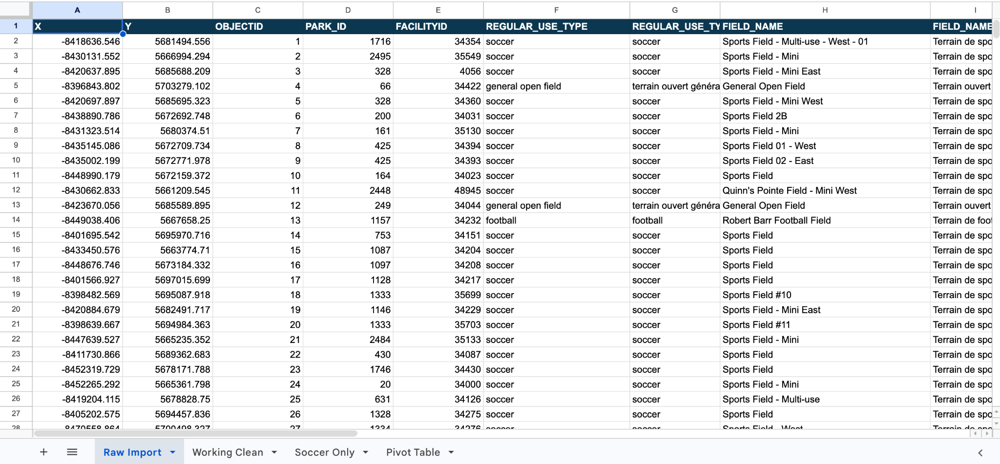

## 1. Getting Data

For this assignment, I analyzed the City of Ottawa’s [Sports Fields dataset](https://open.ottawa.ca/datasets/4a93cd91adb64e38b20aa3edfe2d6148_19) to investigate how many municipal soccer fields have recorded lighting (City of Ottawa, n.d.-a). The data represents sports-field locations on City-owned or leased property; it does not include every school or private field. 

To reproduce the import, download the CSV from Open Ottawa. In Google Sheets, create a blank spreadsheet, choose **File → Import → Upload**, select the CSV, set the separator to **Comma** if necessary, and choose **Insert new sheet(s)**. Rename the resulting tab `Raw Import`, verify that row 1 contains the original headings, and leave it unchanged.  Take an actual Google Sheets screenshot showing row 1 and approximately rows 2–26.

**Google Sheets workbook:** [Ottawa Sports Fields — Raw and Cleaned Analysis](https://docs.google.com/spreadsheets/d/1Zu9UfTZvQte1w2r5IgiBp1ayMuaG0DrAsu3lpN2m8TY/edit). **Before submission:** set *General access → Anyone with the link → Viewer* and verify the link works outside your account.

The supplied CSV has **526 data rows and 26 columns**. There are no blank `LIGHTS` cells, but `OPEN` is blank for all 526 records and `CREATED_DATE` is blank for 452. `REGULAR_USE_TYPE` is a **nominal categorical** variable identifying a sport; `LIGHTS` is **binary nominal categorical**, containing `yes/oui` or `no/non`; `FIELD_SIZE` is an **ordinal category** (mini/intermediate/full), although its intermediate labels are inconsistent. `OBJECTID` is a discrete numeric **identifier**, not a measured quantity. My initial hypothesis was that fewer than one in ten soccer-field records would indicate lights.
