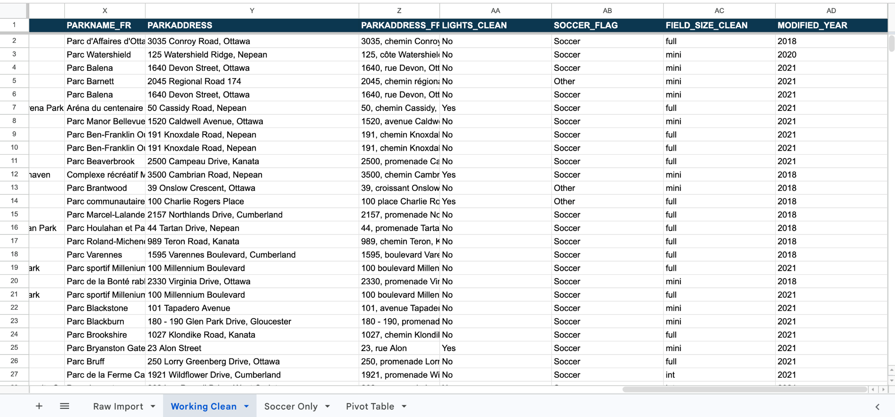
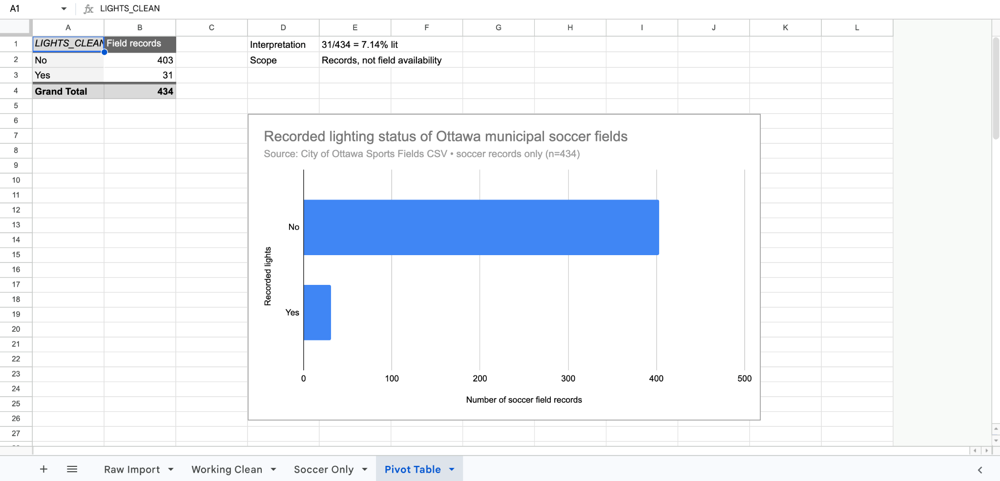
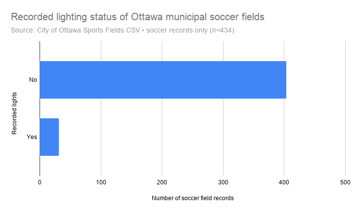

## 2. Understanding Data

### 2.1. VIMO Analysis

I assessed **valid, invalid, missing, and outlier (VIMO)** values before cleaning, following Statistics Canada’s advice to inspect frequency distributions and numerical ranges (Statistics Canada, 2020b). The unit of analysis is an individual **field record**, not a park. The 434 soccer records occur at 234 parks. 

For `LIGHTS`, **526/526 values were valid**: 46 `yes/oui` and 480 `no/non`, with **zero invalid or missing values**. In the 434 records where `REGULAR_USE_TYPE = soccer`, the split was **31 yes and 403 no**. For these nominal codes, numerical outliers are inapplicable. The codes match the City’s GIS definitions (City of Ottawa, n.d.-a). For `REGULAR_USE_TYPE`, all 526 values were nonblank, forming **eight distinct categories**, including 434 `soccer`, 33 `general open field`, and 32 `football`. I excluded `multi-use` records from soccer-specific counts.

`FIELD_SIZE` required attention. Of 526 entries, **237 were `full`, 237 `mini`, 48 `int`, three `interm`, and one `Int`**. These are **label anomalies**, not proven measurement errors. I standardized them to `int` in a helper column, producing 52 intermediate records. For numerical outlier screening, soccer-field `WIDTH` ranged **17–90** and `LENGTH` **25–118**, with no blanks. Units and extreme measurements require City verification.

All 526 `OBJECTID` values and `FACILITYID` values were unique, and no full rows were duplicated. Repeated `FIELD_NAME` labels do not establish duplicates. Other limitations affect reliability: **452/526 `CREATED_DATE` cells and 526/526 `OPEN` cells were missing**, the most recent `MODIFIED_DATE` in this CSV is **September 7, 2022**, and the catalogue describes updates as “as required” with accuracy unavailable (Canadian Urban Data Catalogue, n.d.). Thus, results describe **this CSV snapshot**, not verified 2026 conditions.

### 2.2. Cleaning Data

I kept the 26-column `Raw Import` intact and created `Working Clean`. I used these spreadsheet-cleaning methods:

1. **Freeze the header row:** On `Working Clean`, select **View → Freeze → 1 row** so column labels remain visible. This changes navigation, not values.
2. **Trim and replace whitespace:** Select the text columns and use **Data → Data cleanup → Trim whitespace**. The source contains **one trailing space** in `PARKNAME` for `OBJECTID 302`. Seven `PARKNAME_FR` cells contain non-breaking spaces, which I replaced with ordinary spaces.
3. **Standardize categories:** Use **Find and replace** on `FIELD_SIZE` (or the formula below) to map `Int` and `interm` to `int`. That corrects **four inconsistent category entries**, without changing the original field-size values in `Raw Import`.
4. **Audit duplicates:** Use **Data → Data cleanup → Remove duplicates** with **only `OBJECTID`** selected. I found **zero** duplicates and removed no rows.

For helper columns, `F` is sport, `K` field size, and `R` lights. Enter these in row 2:

```gs
=IF(R2="","Unknown",IF(LOWER(TRIM(R2))="yes/oui","Yes",IF(LOWER(TRIM(R2))="no/non","No","Review")))
```

```gs
=IF(LOWER(TRIM(F2))="soccer","Soccer","Other")
```

```gs
=IF(OR(LOWER(TRIM(K2))="int",LOWER(TRIM(K2))="interm"),"int",LOWER(TRIM(K2)))
```

Copy down through row **527**. The cleaned table still has **526 records**, including **434 soccer records**. The `LIGHTS_CLEAN` categories include no unknown or review entries. The original raw sheet remains unchanged.



### 2.3. Analyzing Data

Categorical lighting and sport values suit frequency comparisons (Statistics Canada, 2020a). In Google Sheets, choose **Insert → Pivot table**, with the cleaned records `Working Clean!A1:AD527` as the source. Add the filter `SOCCER_FLAG = Soccer`; add `LIGHTS_CLEAN` under **Rows**; and use `OBJECTID` under **Values**, summarized by **COUNTA**. Exclude the grand total when charting. The audited pivot results are **31 Yes, 403 No, 0 Unknown, 0 Review**: **31/434 = 7.14%** with recorded lights, compared with **92.86%** without.



I charted **31 versus 403** using bars on a shared zero baseline; length is easier to compare precisely than pie-slice angles (UC Berkeley Library, n.d.). To reproduce it, select the pivot’s category/count cells, choose **Insert → Chart → Bar chart**, label the axis “Number of soccer-field records,” and use the chart menu to download a PNG.



A secondary cross-tab suggests a similar pattern by size: **15/213 mini fields (7.0%)**, **14/179 full fields (7.8%)**, and **2/42 intermediate fields (4.8%)** have recorded lights.  The sharper story is that **only 16 of 234 parks with soccer fields** have at least one soccer-field record marked as illuminated. My next step would be to map these locations and verify operating hours and availability. The chart alone cannot establish equitable evening access.
