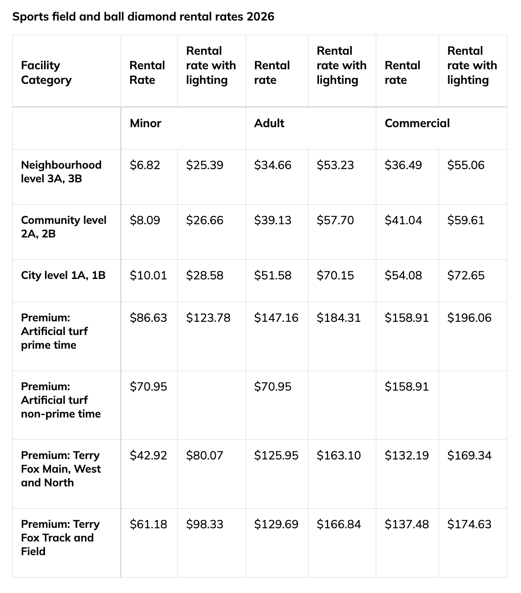

## 3. Delivering Data

The exploratory finding is striking: just **31 of 434 municipal soccer-field records (7.1%)** in the supplied export indicate lighting. However, that number is a starting point, not the complete story. To understand evening recreation, I would need the location of each illuminated field, up-to-date lighting status, seasonal operating hours, booking schedules and information about public transportation. A park-level map would prevent counting multiple fields at one park as separate places. The City’s 2026 rental schedule lists adult neighbourhood-level field rates of **$34.66 per hour without lighting** and **$53.23 per hour with lighting**, an **$18.57 hourly difference** (City of Ottawa, n.d.-b). These are permit rental prices, not evidence that every player pays to use a field.

Brewer Park offers a concrete human-interest example. In October 2022, recreational players petitioned for longer floodlight access, reporting that shorter daylight hours were affecting their games (Daniel, 2022). Ottawa City Council's December 14, 2022 agenda records a related submission with 111 names (City of Ottawa, 2022). I would contact an organizer to check current conditions.

I would interview a player or league organizer and ask City staff about installations, permits and operating hours. The [Sports Fields GIS layer](https://maps.ottawa.ca/arcgis/rest/services/Parks_Inventory/MapServer/19) can support an ArcGIS StoryMap, while the City’s [sports-field rental information](https://ottawa.ca/en/recreation-and-parks/parks-facilities-and-rentals/rental-information/outdoor-rentals-parks-sports-fields-ball-diamonds-tennis-and-pickleball/rent-sports-fields-and-ball-diamonds) offers context. My final StoryMap would combine a field map, a chart, dusk photographs and verified interview quotes, distinguishing installed lights from usable playing time.

*Figure 5. City of Ottawa (n.d.-b), 2026 sports-field and ball-diamond rental rates. Screenshot captured November 5, 2026. The adult neighbourhood-level rates are $34.66/hour without lighting and $53.23/hour with lighting.*
